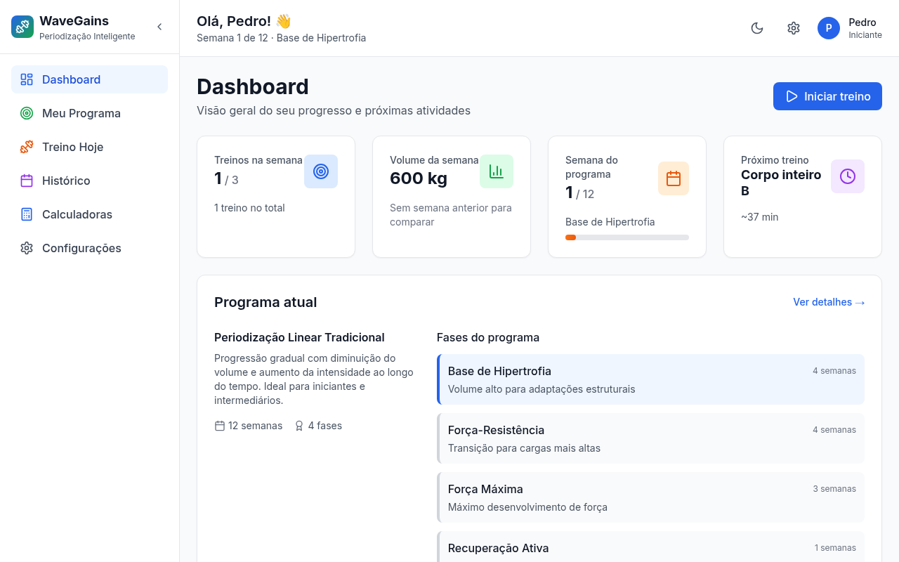
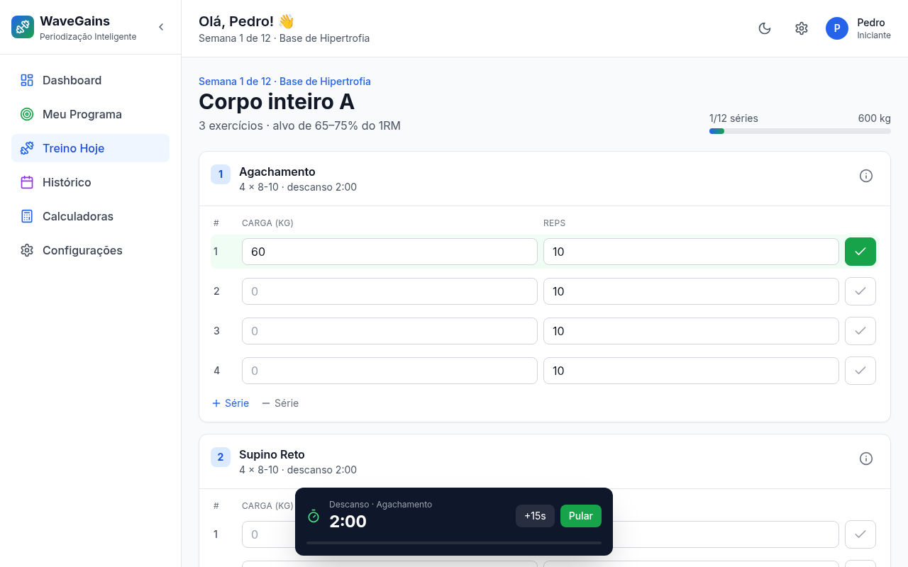
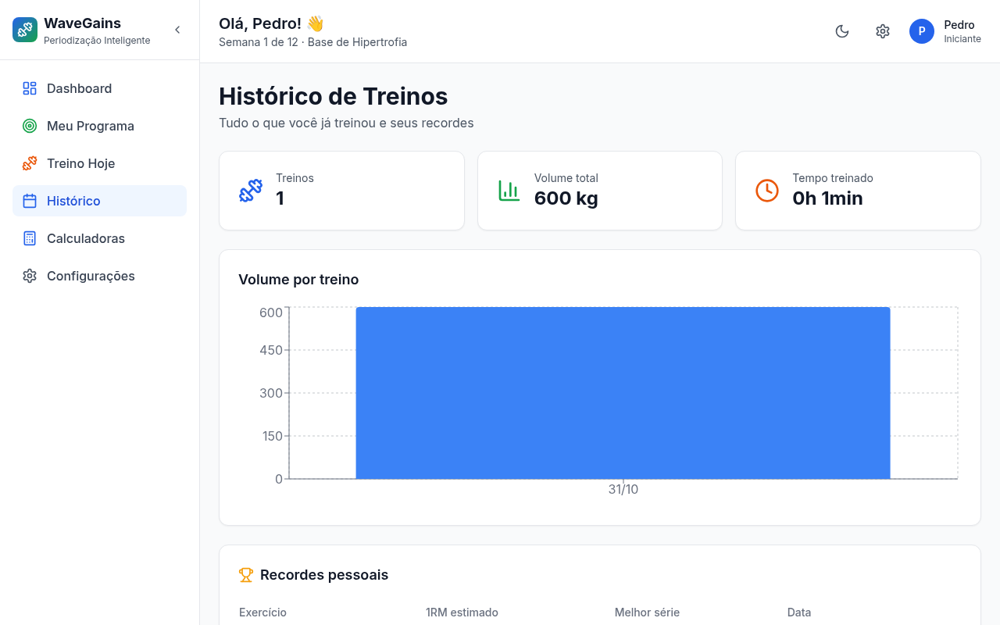
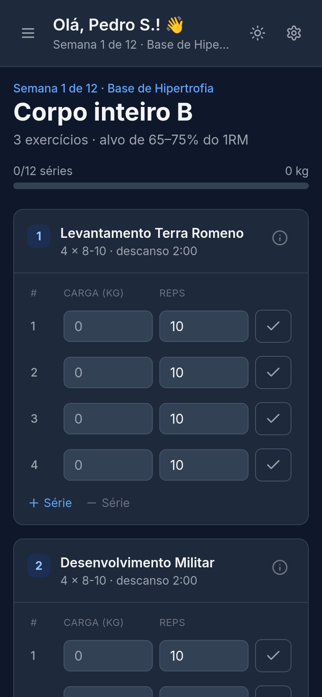

# WaveGains

Aplicativo web de **periodização de treinos para hipertrofia**: você responde um questionário, recebe um programa
de várias semanas, executa os treinos do dia com cronômetro de descanso e acompanha volume, recordes e evolução.

**Demo:** https://wave-gains.vercel.app

| Dashboard | Treino do dia |
| --- | --- |
|  |  |

| Histórico | Mobile (tema escuro) |
| --- | --- |
|  |  |

## O que o app faz

- **Questionário inicial** que estima seu nível e recomenda um programa (linear, ondulatório/DUP, por blocos ou conjugado).
- **Programa por fases**: o app calcula a semana e a fase atuais pela data de início e ajusta séries, repetições,
  faixa de intensidade e descanso para cada fase.
- **Treino do dia gerado automaticamente**: divisão conforme seus dias por semana (corpo inteiro, superior/inferior ou
  push/pull/legs), quantidade de exercícios conforme seu tempo disponível, cargas já preenchidas com a última usada.
- **Execução do treino**: carga e repetições por série, adicionar/remover séries, instruções de cada exercício,
  **cronômetro de descanso** (com aviso sonoro e vibração) e resumo com **recordes pessoais** ao finalizar.
- **Histórico**: treinos realizados, volume por treino, tempo treinado e tabela de recordes (1RM estimado).
- **Dashboard com dados reais**: treinos da semana, volume e variação contra a semana anterior, progresso no programa
  e evolução de força. Quando ainda não há dados, mostra estados vazios em vez de números inventados.
- **Calculadoras**: 1RM (Epley, Brzycki, Lombardi, Mayhew), conversão RPE ↔ % do 1RM e volume.
- **Seus dados ficam no seu navegador**: tudo é salvo automaticamente (inclusive o treino em andamento), com
  **exportar/importar backup** em JSON e opção de apagar tudo.
- Tema claro/escuro, layout responsivo (menu lateral vira gaveta no celular) e navegação por teclado.

## Tecnologias

React 19 · TypeScript · Vite 7 · Tailwind CSS 3 · Recharts · Lucide · Vitest · ESLint

## Como executar

Requer Node.js 20+.

```bash
npm install
npm run dev        # desenvolvimento em http://localhost:5173
```

| Script | O que faz |
| --- | --- |
| `npm run dev` | servidor de desenvolvimento |
| `npm run build` | checagem de tipos + build de produção |
| `npm run preview` | serve o build localmente |
| `npm run lint` | ESLint |
| `npm test` | testes unitários (Vitest) |
| `npm run typecheck` | só o TypeScript |

## Estrutura

```
src/
├── components/   telas (Dashboard, WorkoutView, HistoryView, SettingsView...) carregadas sob demanda
├── data/         exercícios, programas de periodização e questionário
├── hooks/        estado do app (com persistência) e cronômetro de descanso
├── types/        tipos compartilhados
└── utils/
    ├── calculations.ts   1RM, RPE e volume
    ├── program.ts        em que semana/fase do programa o usuário está
    ├── workoutPlan.ts    gerador do treino do dia
    ├── stats.ts          volume semanal, recordes, progresso de força
    └── storage.ts        localStorage, rascunho, backup (exportar/importar)
```

## Como o treino do dia é montado

1. `getProgramPosition` descobre a semana e a fase pela data de início do programa.
2. `getSplit` escolhe a divisão pela disponibilidade semanal (≤3 dias: corpo inteiro A/B/C; 4: superior/inferior;
   5+: push/pull/legs) e o dia da vez gira conforme os treinos já concluídos.
3. `buildWorkout` define séries (4 em fase de volume alto, 3 nas demais), repetições (faixa baixa para
   compostos, alta para isoladores) e descanso (maior quando a intensidade da fase é maior).

As faixas vêm de `src/data/programs.ts`; para ajustar um programa ou adicionar exercícios, edite `src/data`.

## Testes

`npm test` cobre a lógica pura: cálculo de 1RM, posição no programa, geração de treinos, volume/recordes e
backup. A CI do GitHub Actions roda lint, testes e build a cada push e pull request.

## Deploy

O projeto é um site estático. Na Vercel (ou Netlify), basta importar o repositório: build `npm run build`,
pasta de saída `dist`.

## Sobre o projeto

O WaveGains nasceu como um projeto de estudo, quando eu estava aprendendo programação. Esta versão revisa a base:
persistência dos dados, treinos de verdade (antes eram telas vazias), dashboard sem números fictícios,
correções de bugs (arredondamento do 1RM, regra do questionário, slider de peso), acessibilidade, testes e CI.

## Próximos passos

- Editar e trocar exercícios do treino do dia
- Ajuste automático de carga com base no RPE informado
- Notificações e lembretes de treino
- Sincronização opcional entre dispositivos

## Aviso

O app é uma ferramenta de organização de treino e não substitui orientação de um profissional de educação física
ou de saúde.
